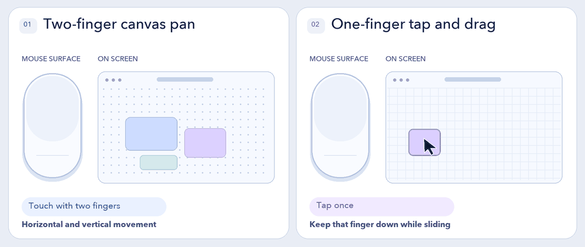
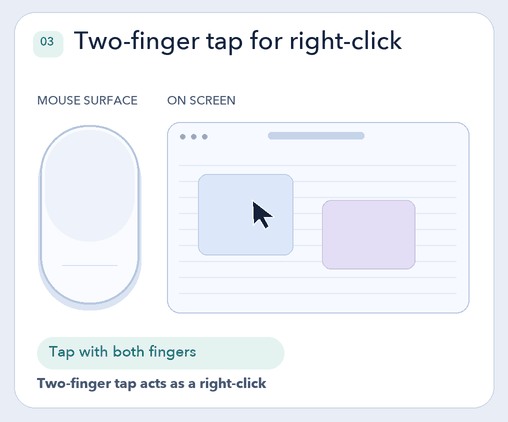

# 妙控鼠标触控板

[English](README.md) · [下载 1.19](https://github.com/gc66656/magic-mouse-trackpad/releases/tag/v1.19)

把苹果妙控鼠标当作一块小触控板。鼠标可以留在桌面原地，用表面触控移动光标、滚动、缩放、旋转和拖拽。



**左侧**双指同向滑动，在支持的设计软件中平移画布。**右侧**单指轻点并抬起，再落指滑动拖拽，最后抬指松开。

**双指轻点右键。** 两指同时轻点鼠标表面，抬起后弹出右键菜单。



## 和上游版本的区别

上游已经支持用触摸移动光标，也会在双指手势中放行 Magic Mouse 的原生滚动事件。Magic Mouse Trackpad 在此基础上加入了明确的单指双击识别和轻点拖拽，并改为直接根据触点位置生成连续的横纵滚动。支持这种输入的设计软件可以用它自由平移画布，包括斜向移动。 [mori0818 的 Magic Mouse Toolkit](https://github.com/mori0818/magic-mouse-toolkit)

- **双指滚动和画布平移。** 双指轻滑即可连续横纵滚动，带惯性，无需停顿或按下鼠标。支持这类输入的设计软件可以用同一手势平移画布。
- **单指轻点拖拽。** 轻点一次，再落指滑动即可拖拽，抬指松开。选取文字或拖动对象时，鼠标可以一直放在桌上。
- **针对鼠标表面优化触摸输入。** 光标随滑动速度调整响应。滚动会过滤小抖动、累积慢滑位移，短暂少报一指时也能继续。

## 安装

1. 从 [1.19 发布页](https://github.com/gc66656/magic-mouse-trackpad/releases/tag/v1.19) 下载 `Magic-Mouse-Trackpad-1.19-macOS.zip` 并解压。
2. 将 **Magic Mouse Trackpad.app** 移到「应用程序」并打开。公开下载使用临时签名，未经过 Apple 公证。如果 macOS 拦截，请确认下载来源后到「系统设置 → 隐私与安全性」选择「仍要打开」，也可以自行从源码构建。
3. 在「系统设置 → 隐私与安全性 → 辅助功能」授权。授权后默认开启触控板模式，可从菜单栏切换。

需要 macOS 26 或更新版本，以及苹果妙控鼠标。下载包同时支持 Apple 芯片和 Intel Mac。设置支持英文和简体中文，可随应用语言切换。

## 手势

| 操作 | 功能 |
| --- | --- |
| 单指滑动或轻点 | 移动光标或左键单击 |
| 连续轻点两次，两次都抬起 | 左键双击 |
| 轻点一次，第二次落指并保持 | 按住左键，滑动手指或移动鼠标本体来拖拽，抬手释放 |
| 双指轻点 | 右键 |
| 双指同向滑动 | 连续横纵滚动，支持惯性 |
| 双指捏合、张开或转动 | 在支持的应用中缩放或旋转 |

手指接管拖拽时，应用会临时断开鼠标本体与系统光标的直接联动，手指停止滑动或抬起时恢复。双指手势在一次操作中只选择一种动作。缩放和旋转依赖 macOS 私有手势字段，实际支持情况随应用和系统版本而异。

## 从源码构建

需要 Xcode 或包含 macOS 26 或更新 SDK 的 Command Line Tools。

```sh
./build.sh
open "build/Magic Mouse Toolkit.app"
```

如果 Command Line Tools 默认使用 macOS 27 SDK 且缺少 SwiftUI 宏插件，可以指定本机已安装的 SDK：`SDKROOT="$(xcrun --sdk macosx26.5 --show-sdk-path)" ./build.sh`。可通过 `SIGN_ID` 为自己的构建指定签名身份。

## 许可证与致谢

本项目遵循 GPL-3.0-only，基于 mori0818 的 [Magic Mouse Toolkit](https://github.com/mori0818/magic-mouse-toolkit)。详见[许可证](LICENSE)和[第三方声明](THIRD_PARTY_NOTICES.md)。
